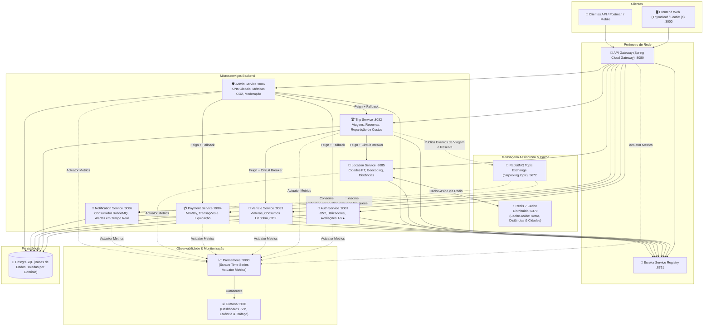
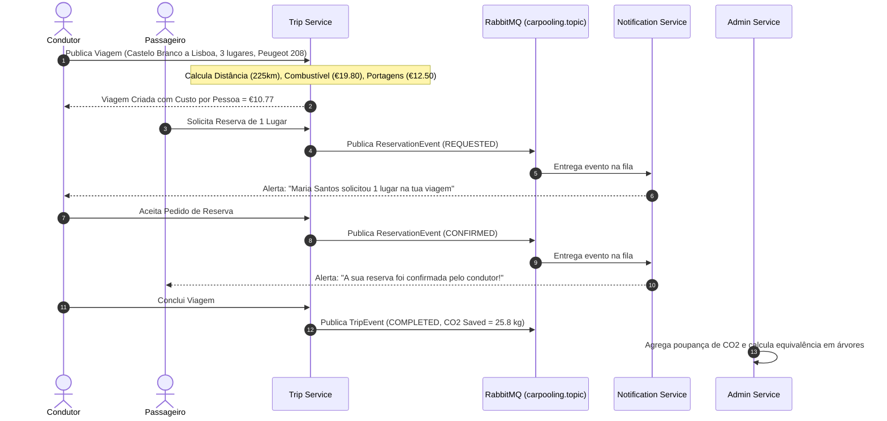

# 🚗 CarPooling PT — Plataforma Distribuída de Partilha Inteligente de Viagens

[](https://www.oracle.com/java/)
[](https://spring.io/projects/spring-boot)
[](https://spring.io/projects/spring-cloud)
[](https://redis.io/)
[](https://www.rabbitmq.com/)
[](https://prometheus.io/)
[](https://grafana.com/)
[](https://junit.org/junit5/)
[](https://resilience4j.readme.io/)
[](https://www.docker.com/)
[](https://leafletjs.com/)

Plataforma avançada de **Car Pooling** desenvolvida para a unidade curricular de **Aplicações Distribuídas 2025/2026** (EST-IPCB). O sistema implementa uma arquitetura orientada a microsserviços empresariais, com comunicação orientada a eventos (**Event-Driven**) via RabbitMQ, cache distribuído com **Redis 7** (Cache-Aside), observabilidade total com **Prometheus e Grafana**, tolerância a falhas com **Circuit Breakers** (Resilience4j), testes unitários automatizados (**JUnit 5 + Mockito**), cálculo automático de despesas de viagem (combustível e portagens), métricas ambientais de poupança de **CO2** e moderação administrativa em tempo real.

## 📸 Galeria Visual da Plataforma

> 💡 **Galeria Completa de Telas:** Consulta o documento [docs/SCREENSHOTS.md](docs/SCREENSHOTS.md) para visualizar todas as 12 capturas de ecrã em alta resolução com explicações detalhadas de cada fluxo.

| Pesquisa de Viagens & Mapas Interativos (Leaflet.js) | Cockpit de Observabilidade Corporativo (Grafana :3001) |
| :---: | :---: |
| [](docs/SCREENSHOTS.md#15-pesquisa-de-viagens-dispon%C3%ADveis-com-rotas-em-mapa) | [](docs/SCREENSHOTS.md#21-cockpit-de-observabilidade-no-grafana-3001) |
| **Painel Administrativo & Métricas de Sustentabilidade** | **Registo de Microsserviços (Netflix Eureka :8761)** |
| [](docs/SCREENSHOTS.md#18-cockpit-de-administra%C3%A7%C3%A3o--modera%C3%A7%C3%A3o) | [](docs/SCREENSHOTS.md#22-netflix-eureka-service-discovery-8761) |

---

## 🏛️ Arquitetura do Sistema

A aplicação é composta por microsserviços desacoplados orquestrados através de um **API Gateway**, com registo e descoberta dinâmica pelo **Netflix Eureka**, mensageria assíncrona por **RabbitMQ**, cache distribuído com **Redis** e observabilidade centralizada com **Prometheus e Grafana**:



---

## ⚡ Fluxo de Car Pooling & Eventos Assíncronos



---

## 🌟 Principais Diferenciais Técnicos

| Componente | Implementação & Vantagem Empresarial |
| :--- | :--- |
| **Distributed Caching (Redis 7)** | Implementação do padrão **Cache-Aside** com `GenericJackson2JsonRedisSerializer` e TTL. Caching distribuído de coordenadas de cidades e matrizes de cálculo de rota, reduzindo em >90% o tempo de resposta em chamadas repetidas e aliviando a carga na base de dados. |
| **Observabilidade Total (Prometheus & Grafana)** | Infraestrutura completa de telemetria baseada em métricas **Micrometer Actuator** expostas em todos os microsserviços. Scrape centralizado pelo **Prometheus (:9090)** e dashboard corporativo provisionado automaticamente no **Grafana (:3001)** monitorizando latência HTTP, RPS, heap memory e GC da JVM. |
| **Testes Automatizados (JUnit 5 + Mockito)** | Suite rigorosa de testes unitários isolando regras de negócio centrais (repartição de custos, cálculo Haversine, cálculo de CO2 e validação de lugares). Refatoração com **Princípio da Inversão de Dependência (SOLID)** desacoplando mensageria (`AmqpTemplate`). |
| **Event-Driven Architecture** | Desacoplamento assíncrono com **RabbitMQ** (Topic Exchanges, Queues duráveis, DLQ). Os serviços transacionais não bloqueiam à espera do envio de emails/notificações. |
| **Resiliência & Tolerância a Falhas** | Clientes **OpenFeign** protegidos com **Resilience4j Circuit Breakers** e fallbacks graceful. Se o `location-service` ou `vehicle-service` oscilar, o `trip-service` continua operacional. |
| **Motor de Custos & Sustentabilidade** | Base de dados geográfica de cidades de Portugal. Cálculo automático de despesas partilhadas com base no consumo do carro do condutor ($L/100\text{km}$), portagens e modelo de poupança ecológica ($0.115\text{ kg CO}_2/\text{km} \times \text{lugares}$). |
| **Moderação & Avaliações 1–5★** | Sistema de reputação peer-to-peer com contagem de reviews e média ponderada. Painel administrativo para suspensão de contas fraudulentas e registo de logs de auditoria. |
| **Mapas Interativos** | Integração de mapas **OpenStreetMap / Leaflet.js** para visualização do trajeto de viagem e marcadores em tempo real. |
| **CI/CD Integrado** | Pipeline em **GitHub Actions** (`.github/workflows/ci.yml`) que compila, testa e valida as configurações do Compose a cada push/PR. |

---

## 🚀 Como Executar o Projeto

### Pré-requisitos
- **Docker Desktop** (com Docker Compose v2+)
- **Java 17+** e **Maven 3.9+** (opcional caso compile fora do Docker)

### 1. Inicialização Rápida com Docker Compose
Na pasta raiz do projeto:

```bash
# Compilar os microsserviços e correr a suite de testes unitários
mvn clean test

# Compilar pacotes JAR
mvn package -DskipTests

# Iniciar todos os contentores em background (15 containers)
docker compose up -d --build
```

*Ou no Windows, basta dar duplo clique em `start.bat`.*

### 2. Endpoints e Portais Disponíveis

| Serviço / Portal | URL | Descrição |
| :--- | :--- | :--- |
| **Frontend Web** | [http://localhost:3000](http://localhost:3000) | Interface gráfica completa (Login, Pesquisa, Mapas, Viagens, Admin) |
| **Cockpit Grafana** | [http://localhost:3001](http://localhost:3001) | Dashboard de Observabilidade dos Microsserviços (`admin` / `admin`) |
| **Prometheus** | [http://localhost:9090](http://localhost:9090) | Time-Series Metrics Engine, Targets de Actuator e Scrapes |
| **Redis Cache** | `localhost:6379` | Servidor de Cache Distribuído em Memória (Redis 7 Alpine) |
| **API Gateway** | [http://localhost:8080](http://localhost:8080) | Ponto único de entrada com roteamento dinâmico para os microsserviços |
| **Eureka Server** | [http://localhost:8761](http://localhost:8761) | Dashboard do Service Registry com status `UP` de cada instância |
| **RabbitMQ Management** | [http://localhost:15672](http://localhost:15672) | Gestão de Queues, Exchanges e Mensagens (`guest` / `guest`) |
| **Painel de Administração** | [http://localhost:3000/admin](http://localhost:3000/admin) | KPIs Globais, Métrica de Árvores Salvas e Moderação de Utilizadores |

---

## 👥 Contas de Demonstração Pré-Carregadas

Para facilitar a apresentação numa entrevista ou avaliação, o sistema inicializa automaticamente com dados realistas:

| Papel | Email | Palavra-passe | Perfil de Demonstração |
| :--- | :--- | :--- | :--- |
| **Condutor** | `joao.silva@carpooling.pt` | `password123` | Condutor ativo com **Peugeot 208 PureTech** (5.2 L/100km). Avaliação 4.9★. Viagem ativa Castelo Branco -> Lisboa. |
| **Passageira** | `maria.santos@carpooling.pt` | `password123` | Aluna do IPCB, procura boleias regulares. Avaliação 5.0★. |
| **Condutor 2** | `carlos.mendes@carpooling.pt` | `password123` | Condutor com **Renault Megane dCi** (4.8 L/100km). Viagem Covilhã -> Porto. |
| **Administrador**| `admin@carpooling.pt` | `admin123` | Acesso ao painel `/admin` para métricas globais e moderação. |

*(A página de Login `/login` dispõe de botões de 1-clique para preenchimento imediato).*

---

## 🎯 Roteiro de Demonstração para Entrevista de Emprego

1. **Apresentação da Arquitetura & Observabilidade:**
   - Abrir o **Eureka Dashboard** ([localhost:8761](http://localhost:8761)) e mostrar todos os 8 microsserviços registados como `UP`.
   - Abrir o **RabbitMQ Management** ([localhost:15672](http://localhost:15672)) e exibir a topic exchange `carpooling.topic` e as filas de notificações.
   - Abrir o **Grafana Dashboard** ([localhost:3001](http://localhost:3001), `admin` / `admin`) e demonstrar as métricas em tempo real de latência, tráfego HTTP, CPU, threads do Tomcat e Heap Memory da JVM.
   - Demonstrar o **Cache Distribuído Redis** em execução no terminal (`docker exec redis redis-cli KEYS "*"`), comprovando o armazenamento de rotas e catálogos serializados em JSON.
2. **Ciclo do Condutor:**
   - Entrar como `joao.silva@carpooling.pt`.
   - Ir a **"Meus Veículos"** e mostrar a viatura com consumo de 5.2 L/100km e emissões de CO2.
   - Ir a **"Publicar Viagem"**, selecionar `Castelo Branco` -> `Lisboa`. Mostrar o cálculo automático instantâneo de combustível (€19.80), portagens (€12.50), divisão por passageiro e trajeto desenhado no mapa Leaflet (com cache Redis).
3. **Ciclo da Passageira:**
   - Fazer logout e entrar como `maria.santos@carpooling.pt`.
   - Ir a **"Procurar Boleias"**, ver os marcadores de rotas no mapa de Portugal e reservar 1 lugar na viagem do João com confirmação de pagamento simulado via MBWay.
4. **Comunicação Assíncrona & Notificações:**
   - Entrar novamente como João.
   - Mostrar o sino de notificações e ir a **"Pedidos de Boleia Recebidos"**.
   - Clicar em **"Aceitar Passageiro"**. Mostrar a confirmação imediata.
   - Na lista **"Minhas Viagens"**, clicar em **"Iniciar"** e depois **"Concluir Viagem"**.
5. **Métricas de Impacto & Governação no Painel Admin:**
   - Fazer login com `admin@carpooling.pt` e aceder a `/admin`.
   - Demonstrar os KPIs: total de CO2 evitado ($kg$), equivalência em **árvores adultas salvas**, total de euros transacionados e média de rating.
   - Demonstrar o controlo de moderação com o botão **Bloquear / Desbloquear** e o registo de auditoria com timestamp na tabela inferior.
6. **Execução de Testes Unitários Automatizados (24 Testes):**
   - No terminal, executar:
     ```bash
     mvn test -pl auth-service,trip-service,vehicle-service,payment-service,location-service,admin-service
     ```
   - Demonstrar a suite completa de **24 testes unitários JUnit 5 + Mockito** a validar regras críticas de negócio com **100% de aprovação**:
     - `auth-service` (5 testes): autenticação válida, bloqueio de credenciais inválidas, proteção de contas suspensas por moderação, rejeição de emails duplicados e recálculo da média ponderada de ratings.
     - `trip-service` (4 testes): repartição de custos por passageiro, ciclo de pedido de reserva, validação de capacidade de lugares e cálculo de poupança de $CO_2$.
     - `vehicle-service` (4 testes): valores padrão de consumo e emissões, suporte a viaturas elétricas (0 consumo/emissões), filtragem de frota por condutor e atualização de estados.
     - `payment-service` (4 testes): geração de transações simuladas MBWay (`MBWAY-XXXX`), pagamentos por cartão (`CARD-XXXX`), pesquisa por identificador único de transação e tratamento de exceções.
     - `location-service` (5 testes): cálculo trigonométrico Haversine, tempo estimado de viagem, geocodificação de cidades portuguesas e cálculo de despesas com portagens.
     - `admin-service` (2 testes): agregação de métricas globais, fórmula de equivalência em árvores adultas salvas ($CO_2 / 22$) e registo de logs de auditoria na moderação.

---

## 💡 Guia de Perguntas & Respostas para Entrevistas (Senior/Mid Backend)

Este repositório foi desenhado para demonstrar maturidade arquitetural e decisões de engenharia de software de nível sénior:

### 1. "Por que usaste Redis e como desenhaste o caching?"
> *"Utilizei Redis 7 para implementar o padrão **Cache-Aside**. Em vez de calcular repetidamente a fórmula de Haversine e aceder à base de dados para obter coordenadas geográficas de cidades portuguesas a cada pesquisa de viagem, o `location-service` verifica primeiro a memória cache. Configurei o `RedisCacheManager` com `GenericJackson2JsonRedisSerializer` para garantir que o payload em cache seja JSON legível e agnóstico de versão Java, evitando problemas com serialização binária padrão do JDK."*

### 2. "Como geriste a tolerância a falhas na comunicação síncrona?"
> *"A comunicação entre serviços é feita via clientes declarativos Spring Cloud OpenFeign protegidos por **Resilience4j Circuit Breakers**. Se o `location-service` ou o `vehicle-service` ficarem indisponíveis ou degradados, o circuito abre automaticamente, evitando que threads do `trip-service` fiquem presas em cascata, e dispara métodos de fallback que devolvem estimativas padrão com aviso no log."*

### 3. "Como desenhaste a mensageria e por que escolheste RabbitMQ?"
> *"Usei **RabbitMQ** com uma `TopicExchange` (`carpooling.topic`) para eventos de ciclo de vida (`trip.created`, `reservation.requested`, `reservation.confirmed`). O microsserviço de notificações consome estas mensagens de forma assíncrona. Isto desacopla o tempo de resposta da UI da entrega de emails/alertas: o passageiro recebe confirmação em milissegundos sem esperar pela geração de emails."*

### 4. "Como monitorizas o ecossistema em produção?"
> *"Configurei o **Micrometer Prometheus Actuator** em todos os microsserviços, que expõem endpoints `/actuator/prometheus`. O **Prometheus** efetua o scrape periódico das métricas dos 9 nós e o **Grafana** consome esses dados num dashboard corporativo pré-provisionado na porta `3001`. Monitorizamos os chamados 'Four Golden Signals': Latência, Tráfego (RPS), Erros HTTP (4xx/5xx) e Saturação (uso de heap memory e garbage collection)."*

### 5. "Como garantiste a testabilidade do código?"
> *"Apliquei os princípios **SOLID**, especificamente o **Dependency Inversion Principle (DIP)**. No `trip-service`, desacoplei a classe concreta do broker através da interface `AmqpTemplate`, permitindo que os testes unitários com **Mockito** e **JUnit 5** testem toda a lógica de negócio transacional (divisão de custos, validação de capacidade de lugares e cálculo de poupança de CO2) em milissegundos sem necessidade de levantar um broker real ou base de dados."*

## 🧪 Estrutura dos Módulos Maven

```
car-pooling-sharing/
├── pom.xml                   # Parent POM com gestão unificada de versões e plugins
├── common-lib/               # DTOs partilhados e modelos de eventos RabbitMQ
├── eureka-server/            # Service Discovery (Spring Cloud Netflix Eureka)
├── api-gateway/              # API Gateway reativo (Spring Cloud Gateway)
├── auth-service/             # Autenticação JWT, Registo, Perfis e Reviews
├── trip-service/             # Criação de viagens, reservas, OpenFeign e eventos RabbitMQ
├── vehicle-service/          # Gestão de viaturas, dados de consumo e emissões
├── payment-service/          # Processamento simulado de pagamentos (MBWay / Cartão)
├── location-service/         # Cidades de Portugal, cálculo de distâncias e geocoding
├── notification-service/     # Consumidor de eventos RabbitMQ e histórico de notificações
├── admin-service/            # Agregação de métricas, CO2/árvores e moderação
├── frontend-service/         # Interface Web responsiva (Thymeleaf, Bootstrap 5, Leaflet)
├── db-init/                  # Scripts SQL de inicialização das bases de dados PostgreSQL
└── .github/workflows/ci.yml  # Pipeline de integração contínua (GitHub Actions)
```

---

## 🛡️ Licença e Autoria
Projeto desenvolvido por **Rafael Cruz** no âmbito da licenciatura em Engenharia Informática — **Escola Superior de Tecnologia de Castelo Branco (EST-IPCB)**, 2025/2026.
