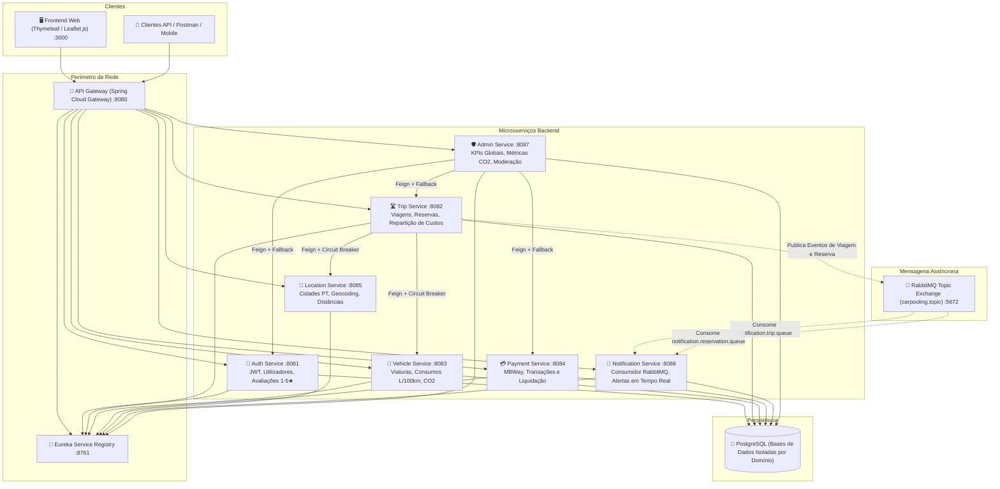

# 🚗 CarPooling PT — Plataforma Distribuída de Partilha Inteligente de Viagens

[](https://www.oracle.com/java/)
[](https://spring.io/projects/spring-boot)
[](https://spring.io/projects/spring-cloud)
[](https://www.rabbitmq.com/)
[](https://resilience4j.readme.io/)
[](https://www.docker.com/)
[](https://leafletjs.com/)

Plataforma avançada de **Car Pooling** desenvolvida para a unidade curricular de **Aplicações Distribuídas 2025/2026** (EST-IPCB). O sistema implementa uma arquitetura orientada a microsserviços empresariais, com comunicação orientada a eventos (**Event-Driven**) via RabbitMQ, tolerância a falhas com **Circuit Breakers** (Resilience4j), cálculo automático de despesas de viagem (combustível e portagens), métricas ambientais de poupança de **CO2** e moderação administrativa em tempo real.

---

## 🏛️ Arquitetura do Sistema

A aplicação é composta por microsserviços desacoplados orquestrados através de um **API Gateway**, com registo e descoberta dinâmica pelo **Netflix Eureka** e mensageria assíncrona por **RabbitMQ**:



---

## ⚡ Fluxo de Car Pooling & Eventos Assíncronos


---

## 🌟 Principais Diferenciais Técnicos

| Componente | Implementação & Vantagem Empresarial |
| :--- | :--- |
| **Event-Driven Architecture** | Desacoplamento assíncrono com **RabbitMQ** (Topic Exchanges, Queues duráveis, DLQ). Os serviços transacionais não bloqueiam à espera do envio de emails/notificações. |
| **Resiliência & Tolerância a Falhas** | Clientes **OpenFeign** protegidos com **Resilience4j Circuit Breakers** e fallbacks graceful. Se o `location-service` ou `vehicle-service` oscilar, o `trip-service` continua operacional. |
| **Motor de Custos & Sustentabilidade** | Base de dados geográfica de cidades de Portugal. Cálculo automático de despesas partilhadas com base no consumo do carro do condutor ($L/100\text{km}$), portagens e modelo de poupança ecológica ($0.115\text{ kg CO}_2/\text{km} \times \text{lugares}$). |
| **Moderação & Avaliações 1–5★** | Sistema de reputação peer-to-peer com contagem de reviews e média ponderada. Painel administrativo para suspensão de contas fraudulentas e registo de logs de auditoria. |
| **Mapas Interativos** | Integração de mapas **OpenStreetMap / Leaflet.js** para visualização do trajeto de viagem e marcadores em tempo real. |
| **CI/CD Integrado** | Pipeline em **GitHub Actions** (`.github/workflows/ci.yml`) que compila, testa e valida as configurações do Compose a cada push/PR. |

---

## 🚀 Como Executar o Projeto

### Pré-requisitos
- **Docker Desktop** (com Docker Compose v2+)
- **Java 17+** e **Maven 3.9+** (opcional caso compile fora do Docker)

### 1. Inicialização Rápida com Docker Compose
Na pasta raiz do projeto:

```bash
# Compilar os microsserviços (se tiver Maven local)
mvn clean package -DskipTests

# Iniciar todos os contentores em background
docker compose up -d --build
```

*Ou no Windows, basta dar duplo clique em `start.bat`.*

### 2. Endpoints e Portais Disponíveis

| Serviço / Portal | URL | Descrição |
| :--- | :--- | :--- |
| **Frontend Web** | [http://localhost:3000](http://localhost:3000) | Interface gráfica completa (Login, Pesquisa, Mapas, Viagens, Admin) |
| **API Gateway** | [http://localhost:8080](http://localhost:8080) | Ponto único de entrada com roteamento dinâmico para os microsserviços |
| **Eureka Server** | [http://localhost:8761](http://localhost:8761) | Dashboard do Service Registry com status `UP` de cada instância |
| **RabbitMQ Management** | [http://localhost:15672](http://localhost:15672) | Gestão de Queues, Exchanges e Mensagens (`guest` / `guest`) |
| **Painel de Administração** | [http://localhost:3000/admin](http://localhost:3000/admin) | KPIs Globais, Métrica de Árvores Salvas e Moderação de Utilizadores |

---

## 👥 Contas de Demonstração Pré-Carregadas

Para facilitar a apresentação numa entrevista ou avaliação, o sistema inicializa automaticamente com dados realistas:

| Papel | Email | Palavra-passe | Perfil de Demonstração |
| :--- | :--- | :--- | :--- |
| **Condutor** | `joao.silva@carpooling.pt` | `password123` | Condutor ativo com **Peugeot 208 PureTech** (5.2 L/100km). Avaliação 4.9★. Viagem ativa Castelo Branco -> Lisboa. |
| **Passageira** | `maria.santos@carpooling.pt` | `password123` | Aluna do IPCB, procura boleias regulares. Avaliação 5.0★. |
| **Condutor 2** | `carlos.mendes@carpooling.pt` | `password123` | Condutor com **Renault Megane dCi** (4.8 L/100km). Viagem Covilhã -> Porto. |
| **Administrador**| `admin@carpooling.pt` | `admin123` | Acesso ao painel `/admin` para métricas globais e moderação. |

*(A página de Login `/login` dispõe de botões de 1-clique para preenchimento imediato).*

---

## 🎯 Roteiro de Demonstração para Entrevista de Emprego

1. **Apresentação da Arquitetura:**
   - Abrir o **Eureka Dashboard** ([localhost:8761](http://localhost:8761)) e mostrar todos os 8 microsserviços registados como `UP`.
   - Abrir o **RabbitMQ Management** ([localhost:15672](http://localhost:15672)) e exibir a topic exchange `carpooling.topic` e as filas de notificações.
2. **Ciclo do Condutor:**
   - Entrar como `joao.silva@carpooling.pt`.
   - Ir a **"Meus Veículos"** e mostrar a viatura com consumo de 5.2 L/100km e emissões de CO2.
   - Ir a **"Publicar Viagem"**, selecionar `Castelo Branco` -> `Lisboa`. Mostrar o cálculo automático de combustível (€19.80), portagens (€12.50), divisão por passageiro e trajeto desenhado no mapa Leaflet.
3. **Ciclo da Passageira:**
   - Fazer logout e entrar como `maria.santos@carpooling.pt`.
   - Ir a **"Procurar Boleias"**, ver os marcadores de rotas no mapa de Portugal e reservar 1 lugar na viagem do João com confirmação de pagamento simulado via MBWay.
4. **Comunicação Assíncrona & Notificações:**
   - Entrar novamente como João.
   - Mostrar o sino de notificações e ir a **"Pedidos de Boleia Recebidos"**.
   - Clicar em **"Aceitar Passageiro"**. Mostrar a confirmação imediata.
   - Na lista **"Minhas Viagens"**, clicar em **"Iniciar"** e depois **"Concluir Viagem"**.
5. **Métricas de Impacto & Governação no Painel Admin:**
   - Fazer login com `admin@carpooling.pt` e aceder a `/admin`.
   - Demonstrar os KPIs: total de CO2 evitado ($kg$), equivalência em **árvores adultas salvas**, total de euros transacionados e média de rating.
   - Demonstrar o controlo de moderação com o botão **Bloquear / Desbloquear** e o registo de auditoria com timestamp na tabela inferior.

---

## 🧪 Estrutura dos Módulos Maven

```
car-pooling-sharing/
├── pom.xml                   # Parent POM com gestão unificada de versões e plugins
├── common-lib/               # DTOs partilhados e modelos de eventos RabbitMQ
├── eureka-server/            # Service Discovery (Spring Cloud Netflix Eureka)
├── api-gateway/              # API Gateway reativo (Spring Cloud Gateway)
├── auth-service/             # Autenticação JWT, Registo, Perfis e Reviews
├── trip-service/             # Criação de viagens, reservas, OpenFeign e eventos RabbitMQ
├── vehicle-service/          # Gestão de viaturas, dados de consumo e emissões
├── payment-service/          # Processamento simulado de pagamentos (MBWay / Cartão)
├── location-service/         # Cidades de Portugal, cálculo de distâncias e geocoding
├── notification-service/     # Consumidor de eventos RabbitMQ e histórico de notificações
├── admin-service/            # Agregação de métricas, CO2/árvores e moderação
├── frontend-service/         # Interface Web responsiva (Thymeleaf, Bootstrap 5, Leaflet)
├── db-init/                  # Scripts SQL de inicialização das bases de dados PostgreSQL
└── .github/workflows/ci.yml  # Pipeline de integração contínua (GitHub Actions)
```

---

## 🛡️ Licença e Autoria
Projeto desenvolvido por **Rafael Cruz** no âmbito da licenciatura em Engenharia Informática — **Escola Superior de Tecnologia de Castelo Branco (EST-IPCB)**, 2025/2026.
