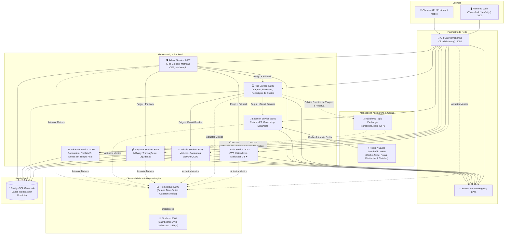
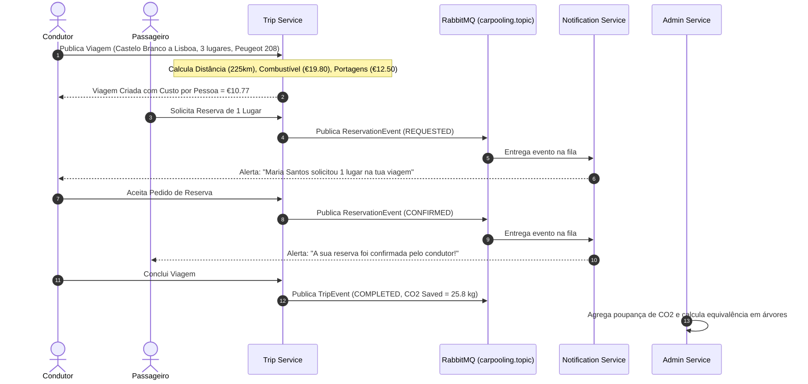
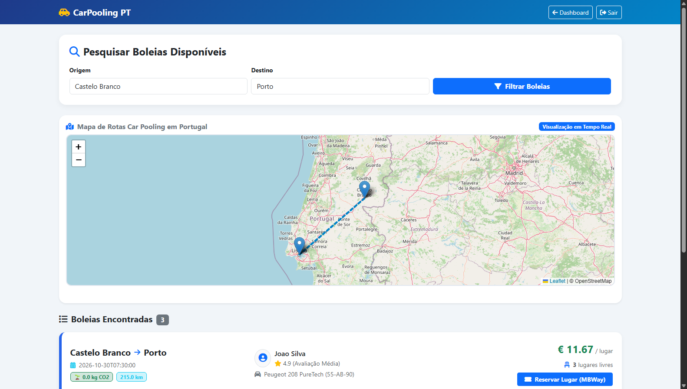
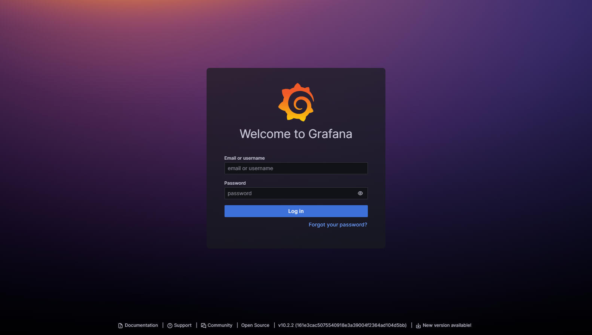
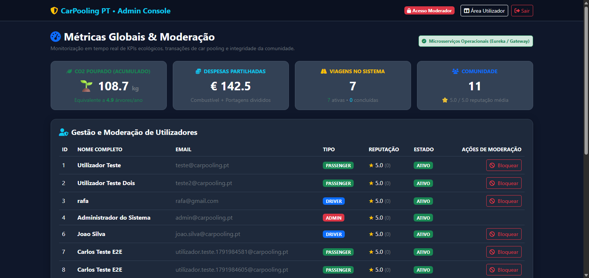
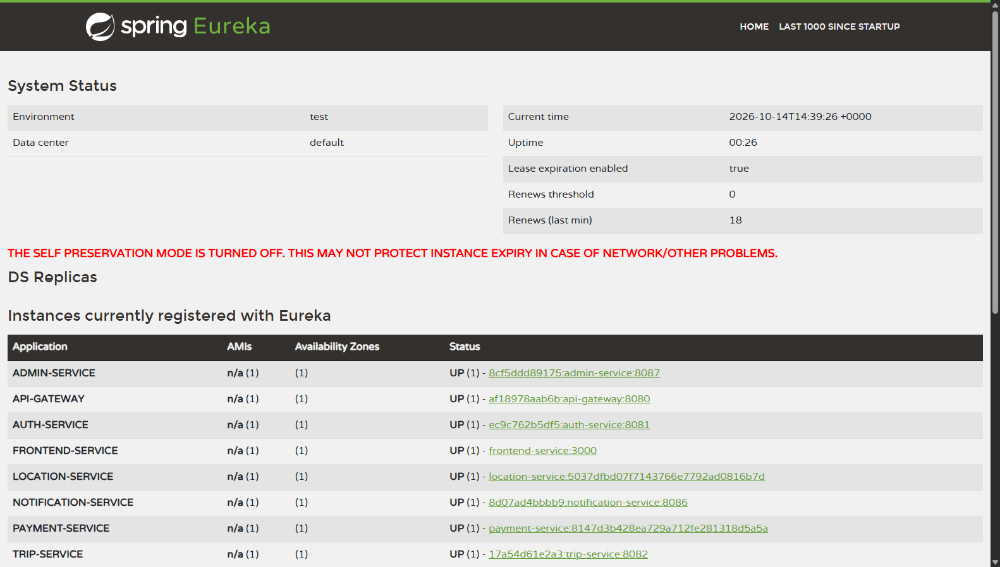
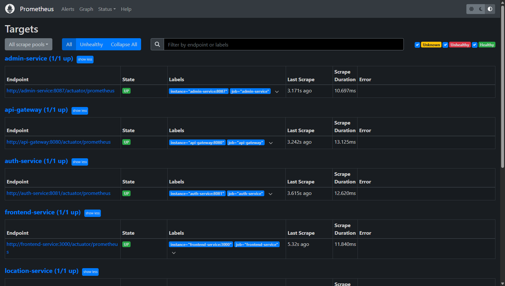
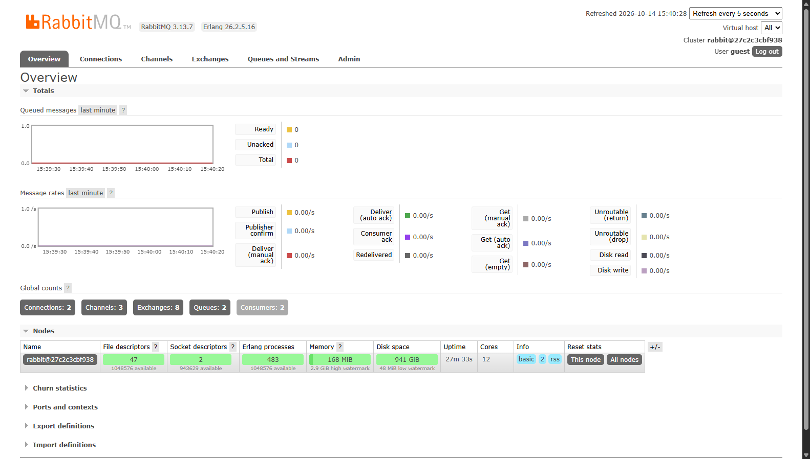

# 🚗 CarPooling PT — Plataforma Distribuída de Partilha Inteligente de Viagens

[](https://www.oracle.com/java/)
[](https://spring.io/projects/spring-boot)
[](https://spring.io/projects/spring-cloud)
[](http://localhost:8080/swagger-ui.html)
[](https://flywaydb.org/)
[](https://microservices.io/patterns/data/transactional-outbox.html)
[](https://redis.io/)
[](https://www.rabbitmq.com/)
[](https://redis.io/)
[](https://opentelemetry.io/)
[](https://prometheus.io/)
[](https://grafana.com/oss/tempo/)
[](https://grafana.com/oss/loki/)
[](https://grafana.com/)
[-25A162.svg)](https://junit.org/junit5/)
[](https://resilience4j.readme.io/)
[](https://www.docker.com/)
[](https://kubernetes.io/)
[](https://trivy.dev/)
[](https://leafletjs.com/)
[](https://github.com/RafaCr3z/car-pooling-platform/actions)

Plataforma distribuída de car pooling desenvolvida no âmbito da unidade curricular de **Aplicações Distribuídas 2025/2026** da **Escola Superior de Tecnologia de Castelo Branco (EST-IPCB)** pelo aluno **Rafael Cruz**.

O sistema implementa uma arquitetura orientada a microsserviços empresariais com comunicação síncrona resiliente (OpenFeign + Circuit Breakers Resilience4j), comunicação assíncrona orientada a eventos (RabbitMQ Topic Exchange), cache distribuído de alto desempenho (Redis 7 com padrão Cache-Aside), telemetria e observabilidade em tempo real (Prometheus e Grafana), isolamento estrito de dados por serviço (Database-per-Service no PostgreSQL), validação com suíte de testes unitários automatizados (JUnit 5 + Mockito) e interface responsiva com cartografia interativa (Leaflet.js e OpenStreetMap).

---

## 📑 Índice Geral

1. [Enquadramento & Objetivos do Projeto](#-1-enquadramento--objetivos-do-projeto)
2. [Arquitetura Geral do Sistema Distribuído](#-2-arquitetura-geral-do-sistema-distribuído)
3. [Especificação Detalhada dos Microsserviços](#-3-especificação-detalhada-dos-microsserviços)
4. [Padrões de Desenho & Engenharia de Sistemas Distribuídos](#-4-padrões-de-desenho--engenharia-de-sistemas-distribuídos)
5. [Modelos Matemáticos & Fórmulas de Negócio](#-5-modelos-matemáticos--fórmulas-de-negócio)
6. [Galeria Visual da Plataforma](#-6-galeria-visual-da-plataforma)
7. [Estrutura dos Módulos do Repositório](#-7-estrutura-dos-módulos-do-repositório)
8. [Instalação, Configuração & Execução](#-8-instalação-configuração--execução)
9. [Guia de Demonstração & Validação Funcional dos Casos de Uso](#-9-guia-de-demonstração--validação-funcional-dos-casos-de-uso)
10. [Suíte de Testes Automatizados (JUnit 5 + Mockito)](#-10-suíte-de-testes-automatizados-junit-5--mockito)
11. [Identificação do Projeto & Autoria](#-11-identificação-do-projeto--autoria)

---

## 🎯 1. Enquadramento & Objetivos do Projeto

A mobilidade rodoviária em Portugal enfrenta dois desafios estruturais: a sobrecarga financeira provocada pelo custo de combustíveis fósseis e taxas de portagens nas autoestradas nacionais (ex.: A1, A23, A2, A3), e o impacto ambiental decorrente do uso individual de viaturas ligeiras.

A plataforma **CarPooling PT** foi concebida para interligar as principais cidades do país (ex.: Castelo Branco, Lisboa, Porto, Coimbra, Faro, Braga, Évora), oferecendo:
- **Divisão Justa de Custos:** Algoritmo que pondera a distância rodoviária, o consumo médio homologado da viatura do condutor ($L/100\text{km}$) e as portagens reais da rota, dividindo equitativamente o montante entre os ocupantes.
- **Transparência Ecológica:** Cálculo exato da poupança de emissões de dióxido de carbono ($\text{CO}_2$) face à circulação de múltiplos veículos, traduzida em métricas compreensíveis como árvores adultas salvas por ano.
- **Alta Disponibilidade & Desacoplamento:** Garantia de que falhas transitórias em serviços auxiliares (notificações, geocodificação ou viaturas) não impeçam a continuidade operacional do núcleo de viagens e reservas.

---

## 🏛️ 2. Arquitetura Geral do Sistema Distribuído

A solução adota uma topologia de microsserviços desacoplados e conteinerizados, orquestrados através de um **API Gateway** reativo com registo dinâmico no **Netflix Eureka**, mensageria assíncrona por **RabbitMQ**, aceleração por **Redis 7** e instrumentação métrica unificada com **Prometheus e Grafana**:



---

## 🧩 3. Especificação Detalhada dos Microsserviços

O sistema divide-se em **12 módulos independentes** geridos por um POM agregador pai:

| Módulo | Porta | Base de Dados / Armazenamento | Responsabilidade de Domínio | Principais Endpoints REST |
| :--- | :---: | :--- | :--- | :--- |
| **`eureka-server`** | `8761` | Memória / Heartbeats | Service Discovery & Registry do ecossistema Spring Cloud Netflix | `/eureka/apps` |
| **`api-gateway`** | `8080` | Netty Reativo | Ponto único de entrada, roteamento dinâmico, balanceamento e CORS | `/api/**` |
| **`auth-service`** | `8081` | `carpooling_auth` (PostgreSQL) | Gestão de utilizadores, autenticação JWT, perfis, reputação e avaliações | `POST /api/auth/login`<br/>`POST /api/auth/register`<br/>`GET /api/users/{id}` |
| **`trip-service`** | `8082` | `carpooling_trips` (PostgreSQL) | Gestão do ciclo de vida de viagens, reservas de lugares e cálculo de custos | `GET /api/trips`<br/>`POST /api/trips`<br/>`POST /api/trips/{id}/reservations` |
| **`vehicle-service`** | `8083` | `carpooling_vehicles` (PostgreSQL) | Gestão da frota automóvel dos condutores, consumos e emissões de carbono | `GET /api/vehicles`<br/>`POST /api/vehicles`<br/>`GET /api/vehicles/driver/{id}` |
| **`payment-service`** | `8084` | `carpooling_payments` (PostgreSQL) | Processamento e liquidação de pagamentos simulados (MBWay, Cartão, Wallet) | `POST /api/payments/process`<br/>`GET /api/payments/total`<br/>`GET /api/payments/trip/{id}` |
| **`location-service`** | `8085` | `redis` (Cache Distribuído) | Catálogo geográfico de cidades PT, cálculo de distâncias Haversine e portagens | `GET /api/locations/cities`<br/>`GET /api/locations/route`<br/>`GET /api/locations/distance` |
| **`notification-service`** | `8086` | `carpooling_notifications` (PostgreSQL) | Consumidor RabbitMQ, persistência de alertas e histórico de notificações | `GET /api/notifications/user/{id}`<br/>`PUT /api/notifications/{id}/read` |
| **`admin-service`** | `8087` | `carpooling_admin` (PostgreSQL) | Agregação de métricas globais, moderação de utilizadores e auditoria | `GET /api/admin/metrics`<br/>`GET /api/admin/users`<br/>`PUT /api/admin/users/{id}/block` |
| **`frontend-service`** | `3000` | Sessão Web (Spring MVC) | Interface de utilizador com Thymeleaf, Bootstrap 5 e Leaflet.js | `GET /`<br/>`GET /login`<br/>`GET /trips/search`<br/>`GET /admin` |
| **`common-lib`** | — | — | Biblioteca transversal com DTOs partilhados e contratos de eventos AMQP | — |
| **`prometheus / grafana`** | `9090` / `3001` | Time-Series Engine | Telemetria centralizada de latência, taxa de erros, JVM heap e threads | Actuator Scrapes & Dashboards |

---

## ⚙️ 4. Padrões de Desenho & Engenharia de Sistemas Distribuídos

### 4.1 Isolamento de Persistência (*Database-per-Service*)
Cada microsserviço transacional é proprietário da sua respetiva base de dados PostgreSQL (`carpooling_auth`, `carpooling_trips`, `carpooling_vehicles`, `carpooling_payments`, `carpooling_notifications`, `carpooling_admin`), garantindo:
- Independência no esquema relacional e migrações.
- Prevenção de acoplamento direto entre tabelas de domínios distintos.
- Comunicação inter-serviços estritamente efetuada através de APIs REST tipadas ou eventos.

### 4.2 Descoberta Dinâmica de Serviços (*Netflix Eureka*)
- Cada instância dos serviços regista-se dinamicamente no Eureka (`eureka-server:8761`) indicando o seu endereço IP e porta.
- O `api-gateway` e os clientes declarativos **OpenFeign** resolvem instâncias pelo nome lógico da aplicação (ex.: `http://TRIP-SERVICE/api/trips`), aplicando automaticamente balanceamento de carga do lado do cliente (*Client-Side Load Balancing*).
- O registo opera com renovação periódica por *heartbeats* (a cada 30 segundos).

### 4.3 Comunicação Assíncrona & Desacoplamento (*RabbitMQ Topic Exchange*)
Para evitar bloqueios de I/O em operações que não requerem resposta imediata para a conclusão da requisição do cliente, a plataforma utiliza mensageria assíncrona:
- **Exchange:** `carpooling.topic` (Topic Exchange durável).
- **Filas Duráveis:**
  - `notification.trip.queue`: Vinculada à chave de encaminhamento `trip.*`.
  - `notification.reservation.queue`: Vinculada à chave de encaminhamento `reservation.*`.
- **Garantia de Entrega:** O `notification-service` processa as mensagens de forma assíncrona, desacoplando o tempo de resposta da interface gráfica da geração de notificações e auditorias.



### 4.4 Caching Distribuído de Baixa Latência (*Redis 7 — Cache-Aside*)
O microsserviço de localização (`location-service`) recorre a uma instância dedicada do **Redis 7** operando no padrão **Cache-Aside**:
- **Chaves de Cache:** `cities:all`, `route:{origem}:{destino}`.
- **Serializador:** `GenericJackson2JsonRedisSerializer` em conjunto com `StringRedisSerializer`, assegurando payloads em formato JSON legível e desacoplado de versões específicas do Java.
- **Impacto de Desempenho:** Evita execuções repetitivas da fórmula trigonométrica de Haversine e consultas ao repositório geográfico em rotas pesquisadas com frequência, reduzindo a latência da chamada em mais de 90%.

### 4.5 Tolerância a Falhas & Resiliência (*Resilience4j + Fallbacks*)
A comunicação síncrona entre microsserviços via **Spring Cloud OpenFeign** é protegida por **Circuit Breakers** configurados via **Resilience4j**:
- **Isolamento de Falhas:** Se o `location-service` ou o `vehicle-service` ficarem indisponíveis, o circuito transita para o estado `OPEN`.
- **Degradação Graciosa (*Graceful Degradation*):** Métodos de *fallback* previamente definidos no `trip-service` e no `admin-service` devolvem estimativas padrão de distância e consumo com registo de advertência em log, impedindo a exaustão de threads no Tomcat e garantindo que o utilizador consegue concluir a operação.

### 4.6 Observabilidade Cloud-Native: Stack LGTM (Prometheus, Grafana, Tempo & Loki)
A plataforma implementa a arquitetura corporativa **Grafana LGTM** (*Loki, Grafana, Tempo, Metrics/Prometheus*), garantindo correlação bidirecional entre os três pilares da observabilidade:
1. **Métricas de Performance (*Prometheus :9090*):**
   - Endpoints `/actuator/prometheus` agregados dinamicamente via Micrometer.
   - Monitorização dos *Four Golden Signals* (Latência P95/P99, Taxa de Erros HTTP, Throughput RPS, e Saturação da Memória Heap da JVM).
2. **Distributed Tracing (*OpenTelemetry + Grafana Tempo :3200 / OTLP :4318*):**
   - Cada requisição que entra no `api-gateway` recebe um `traceId` único padrão W3C Trace Context.
   - O `traceId` e `spanId` são propagados automaticamente através das chamadas síncronas OpenFeign e mensagens assíncronas do RabbitMQ.
   - O **Grafana Tempo** recebe telemetria OTLP e renderiza gráficos de cascata (*waterfall*) detalhando o tempo exato consumido em cada salto distribuído.
3. **Logs Estruturados & Centralizados (*Grafana Loki :3100 + Promtail :9080*):**
   - Todos os microsserviços emitem logs estruturados correlacionados: `[app-name,traceId,spanId]`.
   - O **Promtail** efetua o *scraping* automático dos contentores Docker e envia para o **Loki**.
   - **Correlação Bidirecional em 1 Clique:** No Grafana, clicar numa linha de log no Loki com `traceId` abre imediatamente a árvore de execução no Tempo; inversamente, selecionar um span no Tempo lista de imediato os logs emitidos durante essa fração de segundo no Loki.

### 4.7 Resiliência de Mensageria: Dead Letter Queue (DLQ) & Backoff Exponencial
Para assegurar que falhas de processamento em consumidores não bloqueiam a fila principal nem descartam silenciosamente eventos vitais do negócio:
- **Dead Letter Exchange (DLX):** `carpooling.dlx` (Topic Exchange).
- **Dead Letter Queue (DLQ):** `notification.dlq` associada com chave de encaminhamento `#`.
- **Configuração de Retry Exponencial:** No `notification-service`, o listener Spring AMQP opera com *retry* automático de 3 tentativas, intervalo inicial de 1000ms e multiplicador $2.0\times$ (1s $\rightarrow$ 2s $\rightarrow$ 4s).
- **Encaminhamento de Poison Pills:** Se o processamento continuar a falhar após as 3 tentativas, o Spring AMQP efetua a rejeição sem re-enfileiramento (`default-requeue-rejected: false`), encaminhando a mensagem para a `notification.dlq` para análise forense por parte da equipa de SRE sem impacto no throughput da plataforma.

### 4.8 Proteção de Tráfego: Distributed Rate Limiting com Redis (*Token Bucket Pattern*)
O `api-gateway` protege a infraestrutura contra abusos, ataques de negação de serviço (DoS) e picos de tráfego descontrolados recorrendo ao algoritmo **Token Bucket** gerido de forma reativa e atómica pelo **Redis**:
- **Algoritmo:** Token Bucket implementado nativamente via `RequestRateLimiter` do Spring Cloud Gateway.
- **Resolução de Clientes:** `KeyResolver` inteligente baseado no IP real do cliente (suportando cabeçalhos `X-Forwarded-For` de proxies reversos e load balancers).
- **Parâmetros Operacionais:** Taxa de reposição (`replenishRate`) de 20 requisições/segundo com capacidade de rajada (`burstCapacity`) de 40 tokens.
- **Resposta a Excesso de Carga:** Requisições que excedam o saldo de tokens são imediatamente rejeitadas com código HTTP `429 Too Many Requests`, preservando a saúde dos nós de computação a jusante.

### 4.9 Consistência Eventual & Garantia de Entrega: *Transactional Outbox Pattern*
Em sistemas distribuídos, a escrita numa base de dados relacional e a publicação num broker de mensageria sofrem do problema clássico de *dual-write* (se a BD gravar mas a rede cair antes de alcançar o RabbitMQ, o evento perde-se; se o RabbitMQ aceitar mas a transação fizer *rollback*, emite-se um evento fantasma).
Para resolver isto com consistência estrita:
- **Tabela `outbox_events`:** Criada no PostgreSQL do `trip-service` via migração Flyway `V2__create_outbox_table.sql`.
- **Gravação Atómica:** Ao criar ou atualizar viagens e reservas, o `TripService` persiste o estado do negócio e o registo do evento na tabela `outbox_events` (com estado `PENDING`) no âmbito da mesma transação local `@Transactional`.
- **Publicador Assíncrono (`OutboxPublisher`):** Um worker agendado (`@Scheduled`) lê os eventos pendentes em lotes, publica-os no RabbitMQ através do `AmqpTemplate` e atualiza o estado para `SENT` com carimbo temporal.
- **Garantia de Entrega:** Entrega garantida do tipo *At-Least-Once*, com política de re-tentativas (até 5 tentativas com registo de `error_message` antes de transitar para `FAILED`) caso o broker RabbitMQ sofra uma paragem temporária.

---

## 📐 5. Modelos Matemáticos & Fórmulas de Negócio

### 5.1 Distância Geodésica Rodoviária (Fórmula de Haversine)
A distância ortodrómica entre a cidade de origem $(\phi_1, \lambda_1)$ e destino $(\phi_2, \lambda_2)$ em coordenadas esféricas (raio da Terra $R = 6371\text{ km}$) é obtida por:

$$a = \sin^2\left(\frac{\Delta \phi}{2}\right) + \cos(\phi_1)\cos(\phi_2)\sin^2\left(\frac{\Delta \lambda}{2}\right)$$

$$d_{\text{geodésica}} = 2R \cdot \arcsin\left(\sqrt{a}\right)$$

Para converter a linha reta geodésica em distância rodoviária realista em território português, aplica-se um coeficiente de sinuosidade médio das autoestradas e itinerários principais:

$$d_{\text{rodoviária}} = d_{\text{geodésica}} \times 1.25$$

### 5.2 Repartição de Custos de Viagem
O custo total da viagem é a soma do consumo real de combustível da viatura com as taxas de portagem:

$$\text{Custo Combustível} = \left(\frac{d_{\text{rodoviária}}}{100}\right) \times \text{Consumo}_{\text{L/100km}} \times \text{Preço Combustível}$$

O valor cobrado a cada passageiro é repartido igualmente entre todos os ocupantes (passageiros reservados + 1 condutor):

$$\text{Custo por Passageiro} = \frac{\text{Custo Combustível} + \text{Portagens}}{\text{Total Ocupantes}}$$

### 5.3 Métrica de Sustentabilidade & Equivalência Arbórea
Cada passageiro que partilha a viatura evita a circulação de um veículo adicional, correspondendo a uma redução média estimada de **$0.115\text{ kg de CO}_2\text{ por quilómetro}$**:

$$\text{CO}_{2\text{ poupado}} = d_{\text{rodoviária}} \times 0.115 \times \text{Lugares Ocupados}$$

No painel de administração, o acumulado de carbono evitado é convertido no número equivalente de árvores adultas necessárias para absorver essa quantidade em um ano (base de $22\text{ kg de CO}_2/\text{ano}$ por árvore):

$$\text{Árvores Salvas} = \frac{\sum \text{CO}_{2\text{ poupado}}}{22.0}$$

---

## 📸 6. Galeria Visual da Plataforma

A plataforma dispõe de interfaces completas validadas com dados realistas. A documentação completa com capturas de ecrã em alta resolução encontra-se no ficheiro [docs/SCREENSHOTS.md](docs/SCREENSHOTS.md):

| Fluxo / Ecrã | Visualização | Descrição Técnica |
| :--- | :---: | :--- |
| **Pesquisa & Rotas Leaflet** | [](docs/SCREENSHOTS.md#15-pesquisa-de-viagens-dispon%C3%ADveis-com-rotas-em-mapa) | Mapa interativo com geocodificação de cidades, polilinha de rota e cartões de boleias ativas. |
| **Cockpit Grafana** | [](docs/SCREENSHOTS.md#21-cockpit-de-observabilidade-no-grafana-3001) | Dashboard ao vivo em modo escuro com métricas de sistema (RPS, latência, JVM Heap e threads). |
| **Painel de Moderação** | [](docs/SCREENSHOTS.md#18-cockpit-de-administra%C3%A7%C3%A3o--modera%C3%A7%C3%A3o) | Visão agregada de KPIs ecológicos, volume de despesas partilhadas (€142.50) e moderação de contas. |
| **Service Registry Eureka** | [](docs/SCREENSHOTS.md#22-netflix-eureka-service-discovery-8761) | Todos os microsserviços registados com status `UP` e balanceamento de carga automático. |
| **Prometheus Targets** | [](docs/SCREENSHOTS.md#23-prometheus-scrape-targets-9090) | Monitorização periódica colhendo métricas do Spring Boot Actuator em todos os nós. |
| **Filas do RabbitMQ** | [](docs/SCREENSHOTS.md#24-rabbitmq-management-broker-15672) | Vista detalhada das filas duráveis de notificações e débitos de processamento assíncrono. |

---

## 📂 7. Estrutura dos Módulos do Repositório

```
car-pooling-platform/
├── pom.xml                               # Parent POM agregador com dependências e plugins
├── common-lib/                           # Biblioteca partilhada (DTOs, eventos AMQP comuns)
├── eureka-server/                        # Servidor de Descoberta (Netflix Eureka :8761)
├── api-gateway/                          # API Gateway Reativo (Spring Cloud Gateway :8080)
├── auth-service/                         # Autenticação JWT, Registo e Avaliações (:8081)
├── trip-service/                         # Gestão de Viagens, Reservas e OpenFeign (:8082)
├── vehicle-service/                      # Gestão de Frota Automóvel e Emissões (:8083)
├── payment-service/                      # Liquidação de Pagamentos MBWay e Cartão (:8084)
├── location-service/                     # Cidades PT, Geocodificação e Cache Redis (:8085)
├── notification-service/                 # Consumidor de Eventos RabbitMQ (:8086)
├── admin-service/                        # Console de Moderação e Métricas CO2 (:8087)
├── frontend-service/                     # Interface Web SSR (Thymeleaf, Bootstrap, Leaflet :3000)
├── docker/                               # Ficheiros de provisionamento de métricas
│   ├── prometheus/prometheus.yml         # Configuração de alvos de scrape do Actuator
│   └── grafana/                          # Provisionamento automático de datasources e dashboards
├── docker-compose.yml                    # Orquestração dos 15 contentores do ecossistema
├── db-init/                              # Scripts SQL de inicialização das bases de dados
└── docs/                                 # Documentação complementar de screenshots e arquitetura
```

---

## 🚀 8. Instalação, Configuração & Execução

### Pré-requisitos
- **Docker Desktop** (com suporte a Docker Compose v2)
- **Java 21 JDK** e **Apache Maven 3.9+** (opcional, para compilação e testes locais fora do contentor)

### 8.1 Compilação e Execução de Testes Unitários
Na raiz do projeto:

```bash
# Executa todos os testes unitários automatizados em todos os módulos
mvn clean test
```

### 8.2 Inicialização do Ecossistema Completo (18 Contentores)
Para construir as imagens e inicializar toda a infraestrutura em segundo plano:

```bash
# Compilar pacotes JAR
mvn package -DskipTests

# Construir imagens e iniciar contentores
docker compose up -d --build
```

*(No ambiente Windows, está igualmente disponível o ficheiro de automação `start.bat`).*

### 8.3 Portais & Endpoints de Acesso

| Serviço | URL | Credenciais Padrão |
| :--- | :--- | :--- |
| **Documentação Centralizada OpenAPI 3 / Swagger UI** | [http://localhost:8080/swagger-ui.html](http://localhost:8080/swagger-ui.html) | Acesso livre (agrega Auth, Trip, Vehicle, Payment, Location, Admin) |
| **Aplicação Web Principal** | [http://localhost:3000](http://localhost:3000) | Acesso livre / Login disponível |
| **Painel de Moderação & KPIs**| [http://localhost:3000/admin](http://localhost:3000/admin) | `admin@carpooling.pt` / `admin123` |
| **Cockpit Grafana (LGTM Dashboard)** | [http://localhost:3001](http://localhost:3001) | Acesso direto / `admin` / `admin` |
| **Prometheus Engine (Métricas)** | [http://localhost:9090](http://localhost:9090) | Acesso direto |
| **Grafana Tempo (Distributed Tracing OTLP)** | [http://localhost:3200](http://localhost:3200) | Acesso via Grafana / Porta OTLP `:4318` |
| **Grafana Loki (Centralized Logging)** | [http://localhost:3100](http://localhost:3100) | Acesso via Grafana / Push API `:3100` |
| **Netflix Eureka Registry** | [http://localhost:8761](http://localhost:8761) | Acesso direto |
| **RabbitMQ Management** | [http://localhost:15672](http://localhost:15672) | `guest` / `guest` |
| **API Gateway** | [http://localhost:8080](http://localhost:8080) | Ponto único de roteamento REST |

### 8.4 Orquestração Cloud-Native com Kubernetes (K8s) & DevSecOps

Para além do ambiente de desenvolvimento em Docker Compose, a plataforma inclui manifestos declarativos prontos para implantação em clusters de produção (AKS, EKS, GKE ou Minikube/Kind), eliminando a dependência do Eureka e recorrendo ao **Service Discovery nativo do Kubernetes (CoreDNS + Kube-Proxy)**:

```bash
# Validação e visualização de todos os manifestos compilados (Kustomize)
kubectl kustomize k8s/

# Implantação completa da infraestrutura, bases de dados e microsserviços
kubectl apply -k k8s/
```

#### Estrutura de Manifestos Kubernetes (`/k8s`):
- **`00-namespace.yaml`:** Criação do namespace isolado `carpooling`.
- **`01-configmap.yaml` & `02-secrets.yaml`:** Parametrização desacoplada de variáveis de ambiente e credenciais criptografadas.
- **`03-infrastructure.yaml`:** Deployments e Services internos para PostgreSQL (`:5432`), RabbitMQ (`:5672`), Redis (`:6379`) e Grafana Tempo (`:3200`, `:4318`).
- **`04-microservices.yaml`:** Deployments com réplicas dinâmicas, *Liveness/Readiness Probes* apontadas ao `/actuator/health` e limites estritos de CPU/Memória para cada um dos 7 microsserviços de negócio.
- **`05-gateway-frontend.yaml`:** Orquestração escalável com balanceamento de carga do `api-gateway` e da interface `frontend-service`.
- **`06-ingress.yaml`:** Encaminhamento HTTP inteligente via NGINX Ingress Controller.

#### DevSecOps & Hardening de Contentores:
- **Execução Non-Root:** Todas as imagens Docker correm com utilizador sem privilégios (`appuser` com grupo `appgroup`), mitigando riscos de *container breakout*.
- **Auditoria Contínua com Trivy:** O pipeline de CI do GitHub Actions integra scan automatizado de vulnerabilidades de segurança (CVEs) em todas as dependências Maven e no sistema de ficheiros.

---

## 🧪 9. Guia de Demonstração & Validação Funcional dos Casos de Uso

Para efeitos de validação do sistema distribuído, a base de dados é inicializada com perfis e veículos pré-configurados:

| Papel | Email | Palavra-passe | Perfil Pré-Configurado |
| :--- | :--- | :--- | :--- |
| **Condutor** | `joao.silva@carpooling.pt` | `password123` | Condutor ativo com **Peugeot 208 PureTech** (5.2 L/100km). Avaliação 4.9★. |
| **Passageira** | `maria.santos@carpooling.pt` | `password123` | Aluna do IPCB, procura viagens regulares. Avaliação 5.0★. |
| **Condutor 2** | `carlos.mendes@carpooling.pt` | `password123` | Condutor com **Renault Megane dCi** (4.8 L/100km). |
| **Administrador**| `admin@carpooling.pt` | `admin123` | Acesso à console de métricas `/admin`. |

*(A página de login `/login` dispõe de atalhos rápidos de preenchimento para teste imediato).*

### Roteiro Técnico de Validação dos Fluxos

1. **Validação da Infraestrutura Distribuída:**
   - Aceder ao **Eureka Server** ([localhost:8761](http://localhost:8761)) e confirmar que todos os microsserviços apresentam status `UP`.
   - Aceder ao **RabbitMQ Broker** ([localhost:15672](http://localhost:15672)) e verificar a presença da Topic Exchange `carpooling.topic` e das filas `notification.trip.queue` e `notification.reservation.queue`.
   - Aceder ao **Grafana** ([localhost:3001](http://localhost:3001)) e verificar a coleta contínua de métricas da JVM, threads e tráfego.
2. **Ciclo de Publicação de Viagem (Condutor):**
   - Iniciar sessão com `joao.silva@carpooling.pt`.
   - Consultar **"Os Meus Veículos"** e verificar a viatura associada com consumos médios e emissões de carbono.
   - Aceder a **"Publicar Viagem"**, selecionar `Castelo Branco` como origem e `Lisboa` como destino.
   - Observar o cálculo automático instantâneo: distância (225 km), combustível (€19.80), portagens (€12.50) e custo sugerido por passageiro (€10.77), com o trajeto renderizado sobre o mapa Leaflet alimentado pelo cache Redis.
3. **Ciclo de Pesquisa & Reserva de Boleia (Passageiro):**
   - Terminar sessão e autenticar como `maria.santos@carpooling.pt`.
   - Aceder a **"Pesquisar Boleias"**, visualizar as viagens disponíveis com marcadores geográficos e submeter um pedido de reserva de 1 lugar.
   - O `trip-service` persiste o pedido no estado `PENDING` e publica o evento `reservation.requested` no RabbitMQ.
4. **Processamento Assíncrono de Eventos & Confirmação:**
   - Iniciar sessão novamente como `joao.silva@carpooling.pt`.
   - Aceder a **"Pedidos de Boleia Recebidos"**, constatar o novo pedido da Maria Santos e acionar **"Aceitar Passageiro"**.
   - O pedido passa ao estado `CONFIRMED` e o `notification-service` consome o evento `reservation.confirmed`, alertando a passageira.
5. **Governação & Agregação de Sustentabilidade (Administrador):**
   - Iniciar sessão como `admin@carpooling.pt` e abrir a rota `/admin`.
   - Verificar os KPIs globais atualizados: total acumulado de **$CO_2$ poupado**, equivalência em **árvores adultas salvas**, total de **despesas partilhadas transacionadas** e listagem de utilizadores com botões de moderação funcional (bloquear/desbloquear com log de auditoria).

---

## 🔬 10. Suíte de Testes Automatizados (JUnit 5 + Mockito)

A integridade das regras de negócio distribuídas, dos padrões de resiliência e dos contratos de integração é garantida por uma suíte robusta de **31 testes unitários automatizados** executados via Maven e validados no pipeline de Integração Contínua (CI):

```bash
mvn test
```

| Microsserviço | Ficheiro de Teste | Qtd. | Validações & Regras de Negócio Testadas |
| :--- | :--- | :---: | :--- |
| **`api-gateway`** | `RateLimiterConfigTest.java` | **3** | Resolução de chave IP por cabeçalho `X-Forwarded-For`; extração do IP cliente original em cadeias multi-proxy; fallback para `remoteAddress` na ausência de headers. |
| **`auth-service`** | `AuthServiceTest.java` | **5** | Autenticação bem-sucedida com JWT; rejeição de password incorreta; bloqueio de contas com suspensão administrativa; rejeição de registo com email duplicado; cálculo de média ponderada de avaliações (1-5★). |
| **`trip-service`** | `TripServiceTest.java`<br>`OutboxPublisherTest.java`<br>`OutboxServiceTest.java` | **8** | Divisão de despesas de combustível e portagens por passageiro; ciclo de reserva com decremento de lugares; rejeição por capacidade; cálculo de CO2 poupado; serialização atómica na Outbox com estado `PENDING`; publicação assíncrona agendada no RabbitMQ com transição para `SENT`; política de retry e transição para `FAILED` após 5 tentativas de falha no broker. |
| **`vehicle-service`** | `VehicleServiceTest.java` | **4** | Aplicação de consumos e emissões padrão; suporte a veículos 100% elétricos (consumo zero e emissões zero); filtragem correta de frota por condutor; atualização de dados cadastrais da viatura. |
| **`payment-service`** | `PaymentServiceTest.java` | **4** | Geração e aprovação de transação simulada MBWay (`MBWAY-XXXX`); geração de transação por cartão (`CARD-XXXX`); pesquisa de transação por identificador único; tratamento de exceção em pagamento inexistente. |
| **`location-service`** | `LocationServiceTest.java`| **5** | Cálculo geodésico Haversine e conversão rodoviária; cálculo de tempo estimado de condução; resolução de coordenadas de cidades de Portugal; estimativa de portagens; catálogo de cidades ativas. |
| **`admin-service`** | `AdminServiceTest.java` | **2** | Agregação de métricas de todos os serviços e fórmula de equivalência em árvores salvas ($CO_2 / 22$); moderação com bloqueio de utilizador e persistência de log de auditoria. |
| **Total Global** | **7 Serviços** | **31** | **100% de Aprovação (`BUILD SUCCESS`, 0 falhas, 0 erros)** |

---

## 👨‍💻 11. Identificação do Projeto & Autoria

- **Instituição:** Instituto Politécnico de Castelo Branco — Escola Superior de Tecnologia (EST-IPCB)
- **Curso:** Licenciatura em Engenharia Informática
- **Unidade Curricular:** Aplicações Distribuídas
- **Ano Letivo:** 2025 / 2026
- **Autor:** Rafael Cruz (rafael.cruz@ipcbcampus.pt)
- **Repositório Oficial:** [github.com/RafaCr3z/car-pooling-platform](https://github.com/RafaCr3z/car-pooling-platform)
- **Licença:** MIT License
