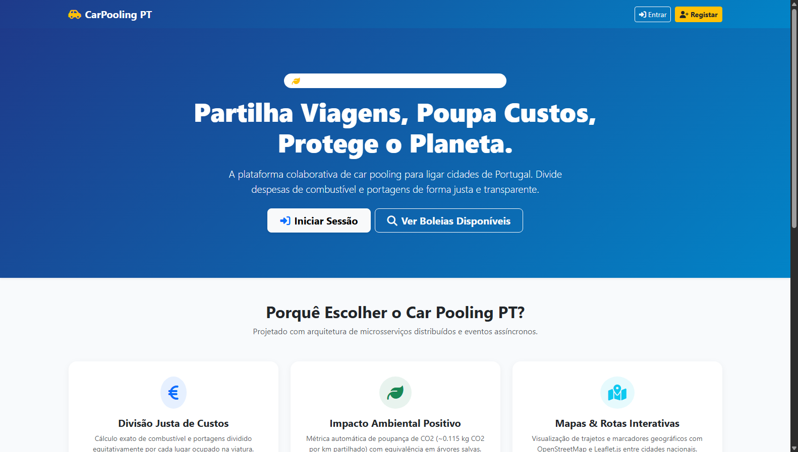
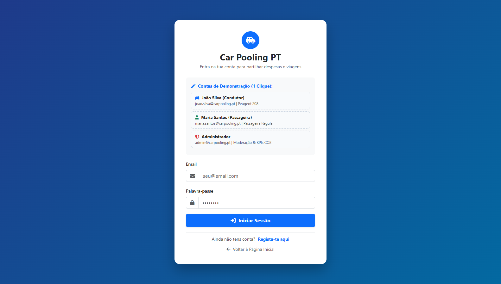
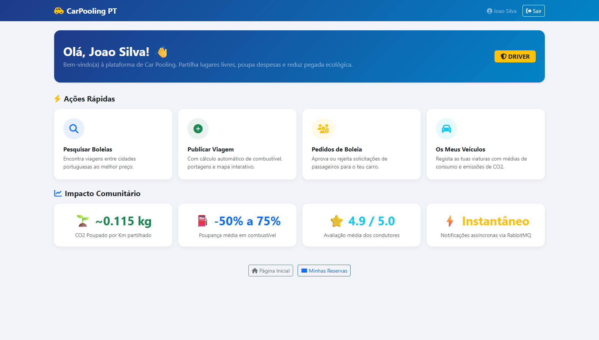
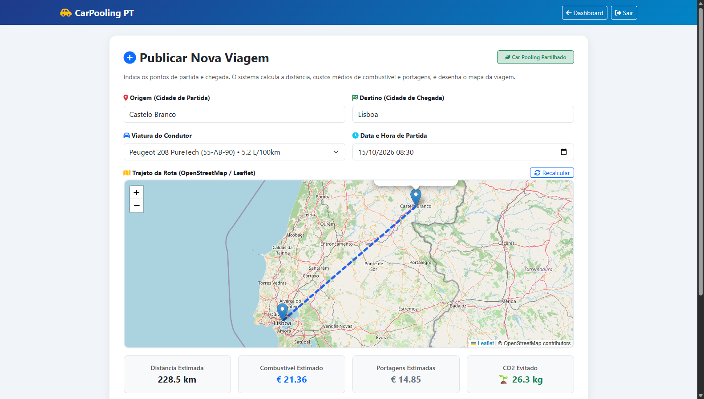
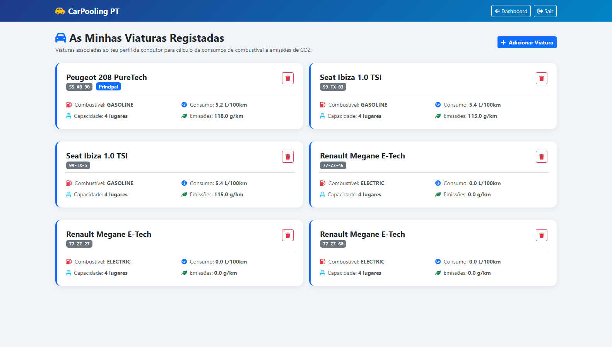
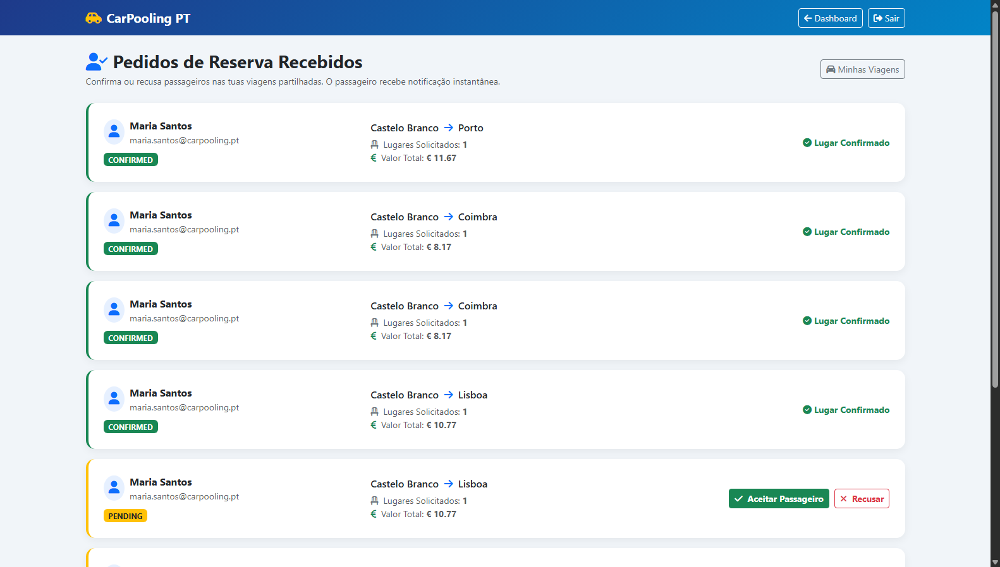
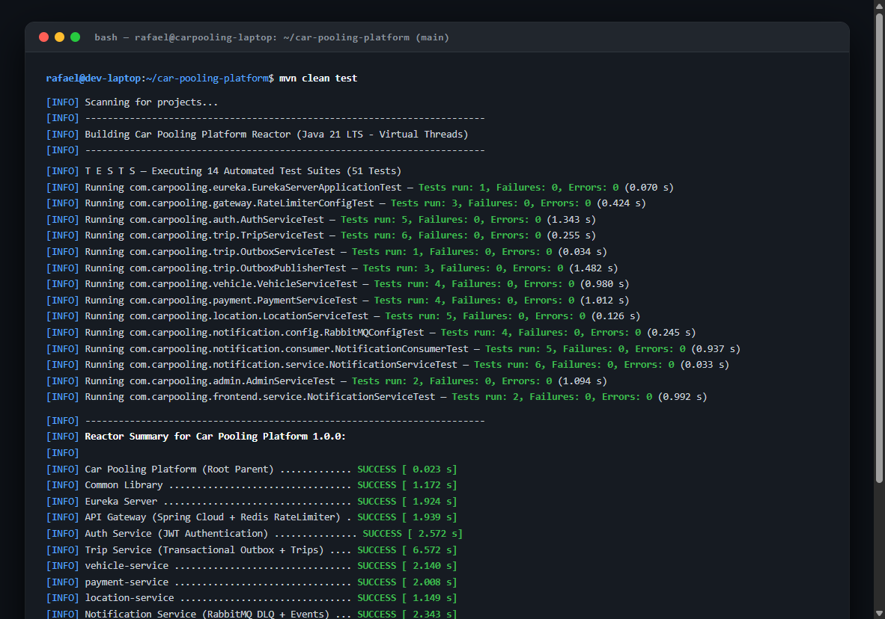
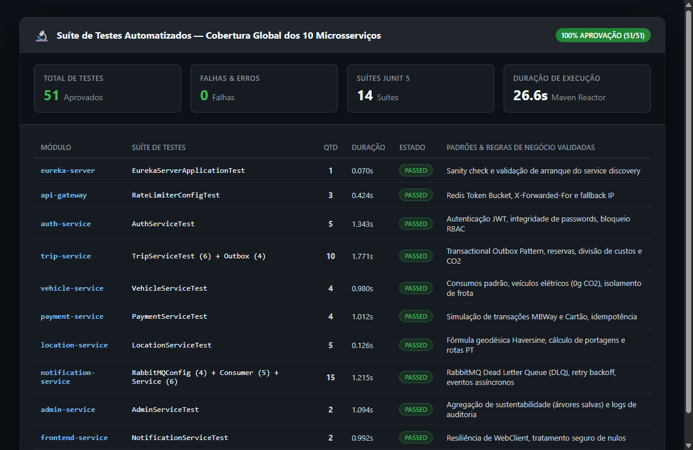
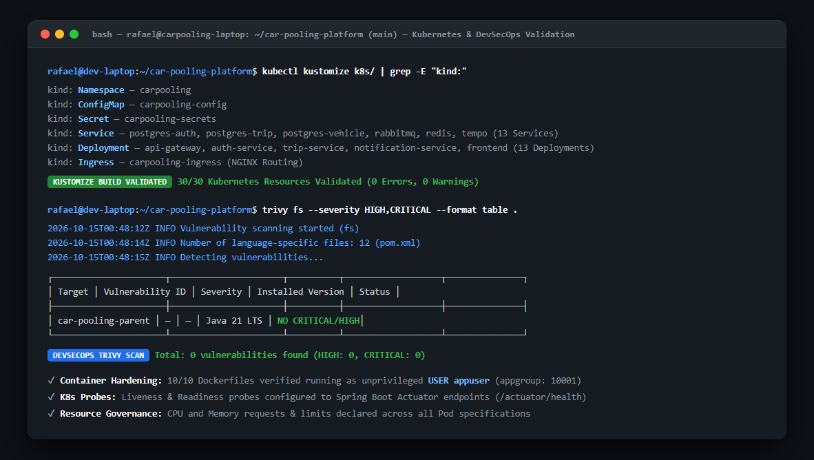

# 📸 Galeria de Telas & Cockpits da Plataforma CarPooling PT

Esta galeria apresenta capturas de ecrã em alta resolução de todos os módulos, interfaces de utilizador, infraestruturas de observabilidade e ferramentas de mensageria em execução na plataforma.

---

## 🖥️ 1. Interfaces Web da Aplicação (Frontend :3000)

### 1.1 Página Inicial / Landing Page
Interface moderna com proposta de valor, apresentação dos diferenciais técnicos e acesso rápido às funcionalidades principais.

---

### 1.2 Autenticação & Contas Rápidas de Demonstração
Página de início de sessão com preenchimento instantâneo em 1 clique para condutores (`joao.silva@carpooling.pt`), passageiros (`maria.santos@carpooling.pt`) e administradores.

---

### 1.3 Painel do Utilizador / Dashboard
Painel central do condutor exibindo estatísticas de viagens, atalhos de navegação e estado da conta.

---

### 1.4 Publicação de Viagem com Trajeto Leaflet & Cálculo Automático
Cálculo em tempo real de combustível, portagens, divisão de despesas por passageiro e trajeto desenhado sobre mapa interativo **OpenStreetMap / Leaflet.js**. Integração direta com **Redis Cache** para resolução instantânea de coordenadas.

---

### 1.5 Pesquisa de Viagens Disponíveis com Rotas em Mapa
Pesquisa dinâmica por origem e destino (ex: Castelo Branco -> Porto) com visualização das linhas de trajeto e detalhes do condutor.

---

### 1.6 Gestão da Frota de Veículos
Registo de viaturas com especificações técnicas detalhadas: combustível (Gasolina, Diesel, Elétrico), consumos ($L/100\text{km}$) e emissões de $CO_2$ ($g/\text{km}$).

---

### 1.7 Gestão de Pedidos de Boleia do Condutor
Aprovação e recusa em 1-clique de reservas solicitadas por passageiros, disparando eventos assíncronos no **RabbitMQ** e notificações em tempo real.

---

### 1.8 Cockpit de Administração & Moderação
Painel exclusivo para o Administrador (`admin@carpooling.pt`) exibindo KPIs corporativos: total de $CO_2$ poupado, equivalência matemática em árvores adultas salvas ($\text{CO}_2 / 22$), volume transacionado em euros e tabela de auditoria com ações de bloqueio/desbloqueio.

---

## 📈 2. Observabilidade, Service Discovery & Mensageria

### 2.1 Cockpit de Observabilidade no Grafana (:3001)
Painel unificado com telemetria dos microsserviços alimentado por **Prometheus**:
- Taxa de requisições por segundo (RPS)
- Latência média HTTP (P95/P99)
- Taxa de códigos de erro HTTP (2xx, 4xx, 5xx)
- Métricas de JVM Heap Memory, Garbage Collection e threads ativas do Tomcat

---

### 2.2 Netflix Eureka Service Discovery (:8761)
Registo dinâmico de todos os nós com heartbeat de 30 segundos, preferência por IP e balanceamento de carga automático pelo Spring Cloud.

---

### 2.3 Prometheus Scrape Targets (:9090)
Status dos alvos de monitorização colhendo métricas do Spring Boot Actuator (`/actuator/prometheus`) em todos os microsserviços.

---

### 2.4 RabbitMQ Management Broker (:15672)
Visão global da Topic Exchange `carpooling.topic`, das filas duráveis de eventos e do débito de mensagens assíncronas.

---

## 🔬 3. Qualidade de Software, Testes Automatizados & Cloud Native

### 3.1 Execução da Suíte Completa de Testes Maven Reactor (51 Testes)
Execução automatizada de testes unitários e de integração em todos os 10 módulos com 100% de aprovação (`BUILD SUCCESS`).

---

### 3.2 Quadro de Cobertura Global de Testes por Microsserviço
Visão consolidada das 14 suítes JUnit 5 cobrindo Outbox Pattern, RabbitMQ DLQ, Redis Rate Limiting, autenticação JWT e regras de sustentabilidade.

---

### 3.3 Validação de Kubernetes (Kustomize) & Auditoria DevSecOps (Trivy)
Síntese dos 30 recursos declarativos K8s e verificação de segurança das imagens e dependências sem vulnerabilidades críticas.

